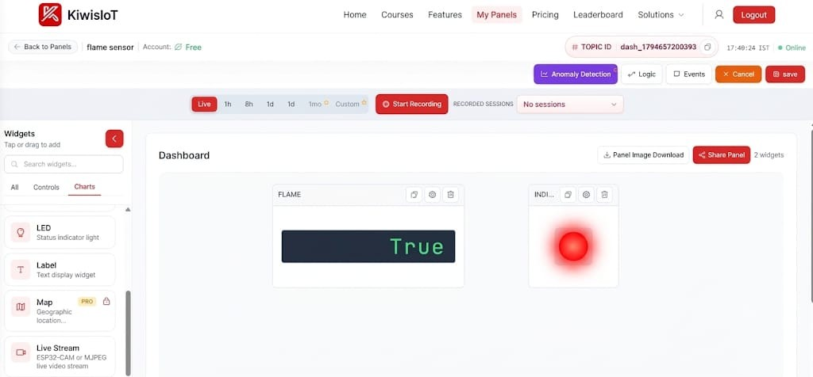

<div align="center">

# 🔥 Flame Guard

### Real-Time Fire Detection System with ESP8266 & KiwisIoT Platform




</div>

---

## 📋 Overview

**Flame Guard** is a beginner-friendly IoT project that detects fire in real time. A flame sensor detects the infrared light given off by a flame, an **ESP8266 NodeMCU** reads the sensor, and the result is sent over Wi-Fi to a **KiwisIoT** dashboard where you can watch it live from anywhere.

The dashboard shows two things:

| Widget | Channel | Shows |
|--------|---------|-------|
| **Label** (Flame status) | 0 | `True` = flame detected, `False` = no flame |
| **LED** (Status indicator) | 1 | 🔴 on (`1`) when a flame is detected, off (`0`) otherwise |

## ✨ Features

- 🔥 Real-time flame detection
- 📡 Wi-Fi monitoring through the KiwisIoT dashboard
- 🔴 Visual LED indicator on the dashboard
- 🖥️ Live status messages in the Serial Monitor
- 🧩 Simple wiring (only 3 connections) and short, readable code
- 🎓 Ideal for college and engineering IoT mini-projects

## 🧰 Components Required

| Component | Quantity |
|-----------|----------|
| ESP8266 NodeMCU | 1 |
| Flame Sensor Module | 1 |
| Jumper Wires | 3 |
| Micro-USB Cable | 1 |
| Computer with Arduino IDE | 1 |

## 💻 Software Required

- [Arduino IDE](https://www.arduino.cc/en/software)
- ESP8266 Board Package
- KiwisIoT Arduino Library
- A free KiwisIoT account

> New to KiwisIoT? Follow the [KiwisIoT Arduino Setup Guide](https://github.com/Kiwistron/KiwisIoT-Projects/tree/main/esp8266/kiwisiot-arduino-setup) first.

## 🔌 Circuit Connection

| Flame Sensor | ESP8266 NodeMCU |
|--------------|-----------------|
| VCC | 3.3V |
| GND | GND |
| DO / OUT | D5 |


## ⚙️ How It Works

1. The flame sensor detects infrared light from a flame.
2. Its digital output (`DO`) goes **LOW** when a flame is detected and stays **HIGH** otherwise.
3. The ESP8266 reads this pin (`D5`) every 2 seconds.
4. The code converts the reading into a status:

   | Sensor Output | Flame Status | LED Status |
   |---------------|--------------|------------|
   | LOW (0) | `True` – Flame detected | `1` |
   | HIGH (1) | `False` – No flame | `0` |

5. The ESP8266 sends the flame status to **Channel 0** and the LED status to **Channel 1** of KiwisIoT.
6. The dashboard updates instantly.

```
Flame Sensor ──► ESP8266 NodeMCU ──► Wi-Fi ──► KiwisIoT ──► Dashboard
                                                   ├── Channel 0 → Flame Status (True / False)
                                                   └── Channel 1 → LED Status   (1 / 0)
```

> ℹ️ Some flame sensor modules work the opposite way. If your status is reversed, change `flameState == LOW` to `flameState == HIGH` in the code.

## 📊 Dashboard Setup

1. Log in to KiwisIoT and create a new **panel**.
2. Add a **Label** widget → name it `Flame`, set **Channel ID = 0**.
3. Add an **LED** widget → name it `Indicator`, set **Channel ID = 1**.
4. Copy the panel's **Topic ID** (looks like `dash_xxxxxxxxxxxxx`).
5. Click **Save**.

> ⚠️ The channel IDs in the dashboard must match the ones in the code.

## 🚀 Getting Started

**1. Open the code**
Open `code/flame-guard-kiwisiot/flame-guard-kiwisiot.ino` in the Arduino IDE.

**arduino code**

```cpp
/*
 * Project: Flame Sensor Fire Detection with ESP8266 and KiwisIoT
 * Project ID: KIWISIOT-007
 * Board: ESP8266 NodeMCU
 * Sensor: Flame Sensor Module
 */

#include <ESP8266WiFi.h>
#include <KiwisIoT.h>

const char* ssid = "YOUR_WIFI_NAME";
const char* pass = "YOUR_WIFI_PASSWORD";

const char* topic = "YOUR_DASHBOARD_TOPIC_ID";

#define FLAME_PIN D5

KiwisIoT kiwisiot(ssid, pass, topic);

void sendFlameStatus() {

  int flameState = digitalRead(FLAME_PIN);

  String flameStatus;

  int ledStatus;

  if (flameState == LOW) {

    flameStatus = "True";
    ledStatus = 1;

  }

  else {

    flameStatus = "False";
    ledStatus = 0;

  }

  Serial.println();
  Serial.println("---------- FLAME MONITORING ----------");

  Serial.print("Flame Sensor Value: ");
  Serial.println(flameState);

  Serial.print("Flame Status: ");
  Serial.println(flameStatus);

  Serial.print("LED Status: ");
  Serial.println(ledStatus);

  if (flameState == LOW) {

    Serial.println("Flame: DETECTED");

  }

  else {

    Serial.println("Flame: NOT DETECTED");
  }

  kiwisiot.send("0", flameStatus);

  Serial.print("Sent to KiwisIoT Channel 0: ");
  Serial.println(flameStatus);

  kiwisiot.send("1", String(ledStatus));

  Serial.print("Sent to KiwisIoT Channel 1: ");
  Serial.println(ledStatus);
}

void setup() {

  Serial.begin(115200);

  Serial.println("     FLAME MONITORING     ");

  pinMode(FLAME_PIN, INPUT);

  Serial.println("Flame sensor initialized");

  Serial.println("Connecting to KiwisIoT...");

  kiwisiot.begin();

  Serial.println("KiwisIoT initialized");

  Serial.println("Starting flame monitoring...");
}

void loop() {

  kiwisiot.run();

  static unsigned long lastSend = 0;

  if (millis() - lastSend >= 2000) {

    lastSend = millis();

    sendFlameStatus();
  }

  delay(100);
}
```

**3. Upload**
Select **NodeMCU 1.0 (ESP-12E Module)** as the board, choose the correct COM port, and click **Upload**.

**4. Monitor**
Open the **Serial Monitor** and set the baud rate to **115200**.

> 🔒 **Security:** never upload your real Wi-Fi password or Topic ID to a public GitHub repository.

## 🖥️ Serial Monitor Output

**Flame detected**
```
---------- FLAME MONITORING ----------
Flame Sensor Value: 0
Flame Status: True
LED Status: 1
Flame: DETECTED
Sent to KiwisIoT Channel 0: True
Sent to KiwisIoT Channel 1: 1
```

**No flame**
```
---------- FLAME MONITORING ----------
Flame Sensor Value: 1
Flame Status: False
LED Status: 0
Flame: NOT DETECTED
Sent to KiwisIoT Channel 0: False
Sent to KiwisIoT Channel 1: 0
```

## 📷 Real-Time Setup


## 🧪 Testing

Bring a **small, controlled flame** (such as a candle or lighter) near the sensor at a safe distance. The dashboard should show `Flame = True` and the LED should light up. Move the flame away and it returns to `False`.

> 🔥 **Safety first:** keep flames away from wires, electronics, people and anything flammable. Always test in a safe, controlled place.

## 🛠️ Troubleshooting

| Problem | Solution |
|---------|----------|
| Dashboard shows no data | Check Wi-Fi name/password, Topic ID, internet connection and that widget channels are **0** and **1** |
| Flame is never detected | Check wiring (OUT → **D5**) and turn the blue potentiometer on the sensor to adjust sensitivity |
| Status is reversed | Your module uses opposite logic – swap `LOW` and `HIGH` in the code |
| LED widget doesn't change | Make sure the LED widget uses **Channel ID 1** |
| Upload fails ("port access denied") | Close the Serial Monitor, check the COM port, then upload again |

## 🌍 Applications

- Fire alarm and fire monitoring concepts
- Home and office safety monitoring
- Kitchen and industrial safety systems
- Smart building safety
- College and engineering IoT projects

## 🔮 Future Improvements

- Add a **buzzer** for a local alarm
- Send **mobile or email notifications** when a flame is detected
- Add a **gas or smoke sensor** for complete fire safety
- Control a **relay or water pump** to respond automatically

## 📁 Project Structure

```
Flame-Guard/
├── README.md
├── LICENSE
├── code/
│   └── flame-guard-kiwisiot/
│       └── flame-guard-kiwisiot.ino
└── images/
    ├── circuit-diagram.jpg
    ├── dashboard-output.jpg
    └── real-time-setup.jpg
```

## 📌 Conclusion

Flame Guard shows how a simple flame sensor and an ESP8266 can become a real-time IoT fire detection system. With just three wires and a short program, flame status can be monitored remotely on a KiwisIoT dashboard, and the project can easily grow into a full safety system.

## 🔗 Links

- [KiwisIoT Projects collection](https://github.com/Kiwistron/KiwisIoT-Projects)
- [KiwisIoT Arduino Setup Guide](https://github.com/Kiwistron/KiwisIoT-Projects/tree/main/esp8266/kiwisiot-arduino-setup)

## 📄 License

This project is released under the [MIT License](LICENSE).
