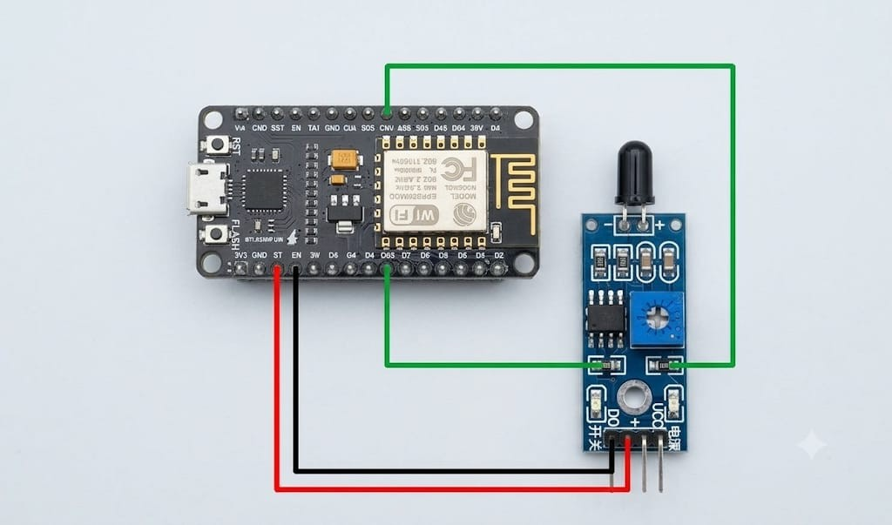
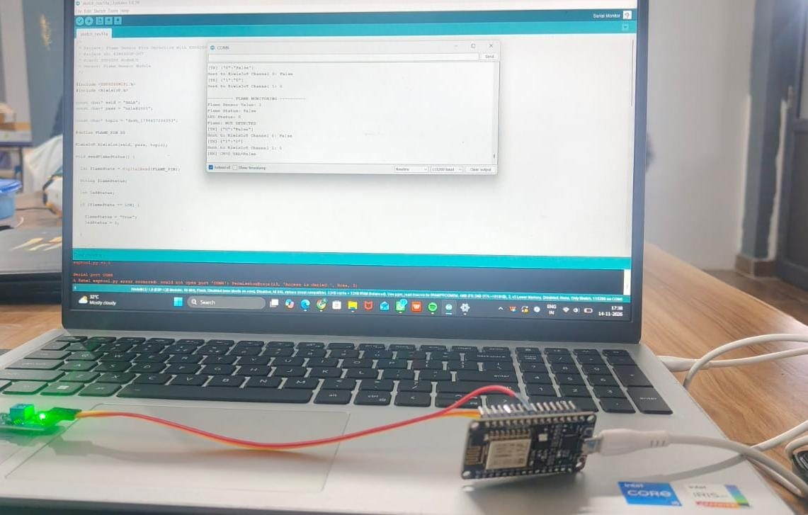

# 🔥 Flame Guard: Real-Time Fire Detection System with ESP8266 & KiwisIoT Platform

**Flame Guard** monitors flame detection in real time. An ESP8266 NodeMCU reads a flame sensor and sends the status to a KiwisIoT dashboard over Wi-Fi.


## ✨ Features
- Real-time flame detection (`True` / `False`)
- LED status indicator on the dashboard (`1` / `0`)
- Two-channel KiwisIoT integration
- Beginner-friendly Arduino project

## 🧰 Components
ESP8266 NodeMCU • Flame Sensor Module • Jumper Wires • USB Cable • Computer

## 🔌 Circuit Connection

| Flame Sensor | ESP8266 NodeMCU |
|--------------|-----------------|
| VCC | 3.3V |
| GND | GND |
| DO / OUT | D5 |



## ⚙️ How It Works
The sensor output is **LOW** when a flame is detected and **HIGH** otherwise. The ESP8266 sends the result every 2 seconds:

| Channel | Data | Values |
|---------|------|--------|
| 0 | Flame status (Label widget) | `True` / `False` |
| 1 | LED status (LED widget) | `1` / `0` |

```
Flame Sensor → ESP8266 → Wi-Fi → KiwisIoT → Dashboard
```

## 🚀 Getting Started
1. Install the Arduino IDE, the ESP8266 board package and the KiwisIoT library ([setup guide](https://github.com/Kiwistron/KiwisIoT-Projects/tree/main/esp8266/kiwisiot-arduino-setup)).
2. Create a KiwisIoT panel with a **Label** (Channel 0) and an **LED** (Channel 1) widget, and copy the **Topic ID**.
3. Open `code/flame-guard-kiwisiot/flame-guard-kiwisiot.ino` and set your details:
   ```cpp
   const char* ssid  = "YOUR_WIFI_NAME";
   const char* pass  = "YOUR_WIFI_PASSWORD";
   const char* topic = "YOUR_DASHBOARD_TOPIC_ID";
   ```
4. Select **NodeMCU 1.0 (ESP-12E Module)**, upload, and open the Serial Monitor at **115200 baud**.

> ⚠️ Never commit your real Wi-Fi password or Topic ID.

## 📷 Real-Time Image


## 🛠️ Troubleshooting
- **Status reversed?** Some modules use opposite logic. Change `flameState == LOW` in the code.
- **No data on dashboard?** Check Wi-Fi details, Topic ID, and that widget channels are 0 and 1.
- **No detection?** Check wiring (OUT → D5) and adjust the blue potentiometer on the sensor.

> 🔥 **Safety:** test with a small, controlled flame, away from wires, electronics and flammable materials.

## 🌍 Applications
Fire monitoring concepts • Safety alert systems • Smart building safety • College IoT projects

## 📁 Structure
```
Flame-Guard/
├── README.md
├── LICENSE
├── code/flame-guard-kiwisiot/flame-guard-kiwisiot.ino
└── images/ (circuit-diagram.jpg, dashboard-output.jpg, real-time-setup.jpg)
```

## 📄 License
[MIT](LICENSE)
